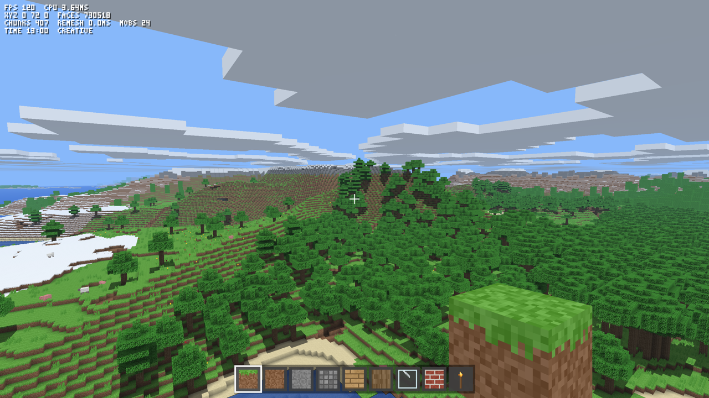
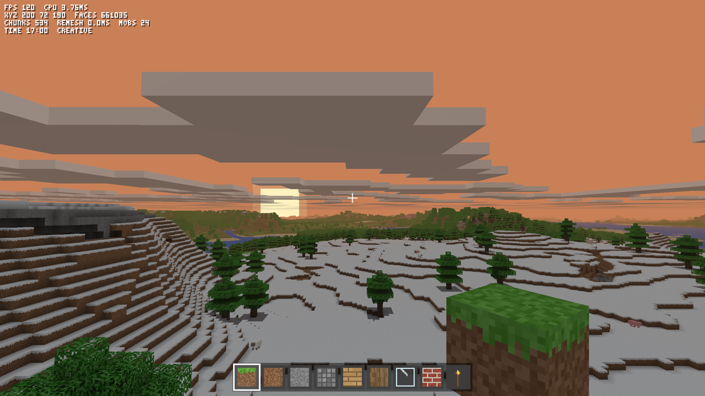
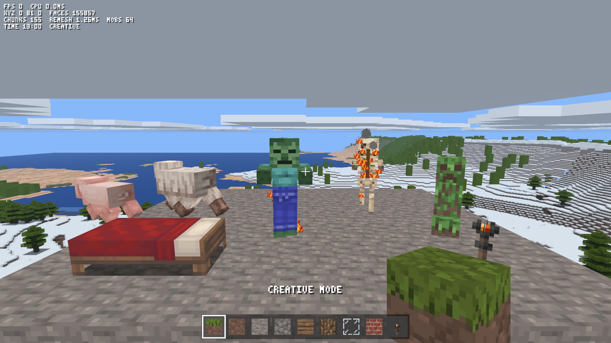
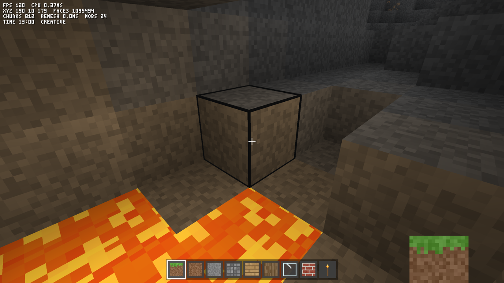
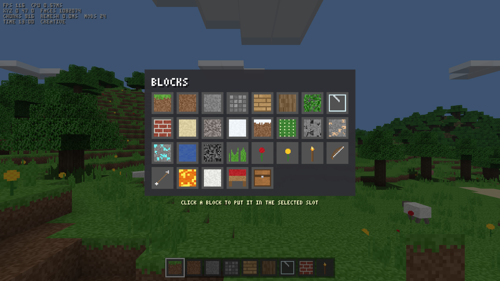
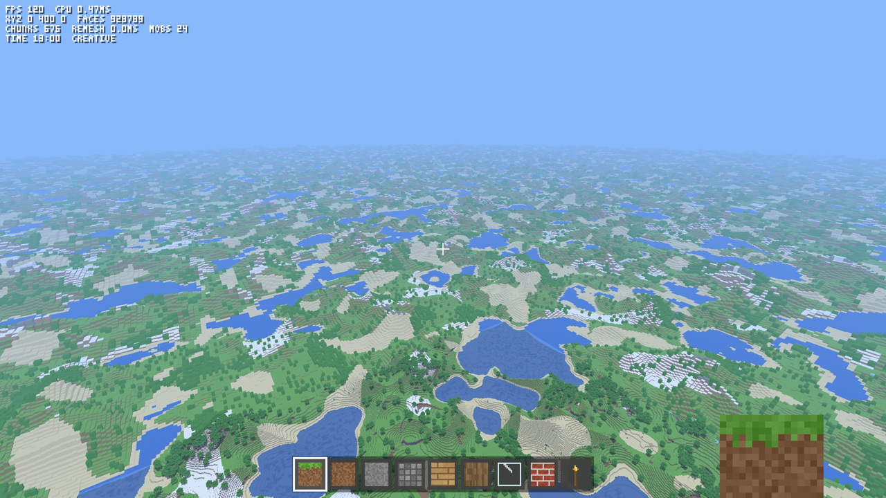

# Spinelcraft

A small Minecraft-like game written in Ruby. The Spinel compiler turns the Ruby into a native executable, and SDL3 GPU (Metal on macOS) draws it. All game logic is Ruby. The only C is a thin layer in `game/gfx.rb` that passes data to SDL.



## Screenshots

| | |
| --- | --- |
|  |  |
|  |  |



`tools/gallery.sh` renders these images again.

## Build and run

You need macOS, SDL3 (`brew install sdl3`) and a built Spinel compiler.

```sh
./build.sh      # writes ./spinelcraft
./spinelcraft
```

`build.sh` uses `$SPINEL` if you set it. Otherwise it uses `spinel` from `PATH`, and then `~/Documents/dev/oss/spinel/spinel`. Use a recent Spinel.

The game saves to `world.sav` in the current directory when you quit, when you press F5, and when it pauses after the world changed. It pauses when you press Esc or when the window loses focus. It loads `world.sav` at start. To get a new world, delete the file or start with `NEW=1`. If `world.sav` exists but does not load, the game renames it to `world-bad.sav` and starts a new world, so the next save does not replace the old one. The save keeps only the chunks that you changed, because the generator makes the same blocks again for every other chunk.

## Controls

| Key | Action |
| --- | --- |
| WASD, mouse | Move, look |
| Space | Jump; swim up; fly up |
| Left Shift | Sneak (slow, never falls off an edge); fly down |
| Left Ctrl, double-tap W | Sprint |
| Left click | Break a block (hold in survival), attack a mob |
| Right click | Place the selected block; open or close a door; use a bed; open a chest (survival); eat food (survival); hold to draw a bow, release to shoot |
| Middle click | Pick the block you look at (creative) |
| 1–9, wheel | Select a hotbar slot |
| E | Inventory: all blocks in creative; the 36-slot backpack in survival (click to move stacks) |
| Q | Next block in the slot (creative); throw one item of the selected stack (survival) |
| C | Craft from the selected stack (survival); the inventory screen also lists every recipe to click |
| F | Fly on or off (creative) |
| G | Switch between creative and survival |
| T | Skip six hours |
| R | Start or stop the rain (creative) |
| F3 | Debug text |
| F4 | View distance: 200 (full detail only, the fastest), 800, 1600 (the default) or 5000 blocks |
| F5 | Save |
| F11 | Fullscreen |
| Esc | Pause and release the mouse |
| N (while paused) | New world from a random seed |

To craft in survival, open the inventory (E) and click a recipe, or press C to craft from the selected stack. The recipes are:

- 1 log gives 4 planks.
- 1 coal gives 4 torches.
- 1 gravel gives 4 arrows.
- 2 stone give 1 brick.
- 3 wool give a bed.
- 5 planks give a bow.
- 6 planks give 3 doors.
- 8 planks give a chest.
- 3 wheat give a loaf of bread.
- 8 cobblestone give a furnace.
- 3 planks, cobblestone, iron ingots or diamond ore give a wooden, stone, iron or diamond pickaxe.
- 2 planks, cobblestone, iron ingots or diamond ore give a wooden, stone, iron or diamond sword.
- 4 planks, cobblestone, iron ingots or diamond ore give a wooden, stone, iron or diamond axe.
- 1 plank, cobblestone, iron ingot or diamond ore gives a wooden, stone, iron or diamond shovel.

These recipes need a furnace within 4 blocks:

- 1 iron ore gives 1 iron ingot.
- 1 porkchop gives 1 cooked porkchop.
- 1 sand gives 1 glass.
- 1 cobblestone gives 1 stone.

Stone, cobblestone, bricks and ores drop nothing unless you use a pickaxe of the right tier. Iron ore needs a stone pickaxe or better, and diamond ore needs an iron one. A better pickaxe also mines faster. An axe chops wood, planks, chests, beds and doors faster, and a shovel digs grass, dirt, sand, gravel and snow faster. A better tier is faster. Tools wear out: a wooden, stone, iron or diamond tool breaks after 60, 130, 250 or 1560 uses, and a bow after 380 shots. A bar under the icon shows the uses that are left. Logs, dirt, sand and gravel need no tool, so start by punching a tree.

## What is in it

- An endless world, 96 blocks tall. Chunks of 16 × 16 columns generate as you move and unload behind you. Perlin noise makes continents, hills, ridged mountains, beaches, oceans, deserts with cactus, and snowy peaks. Caves are long tunnels. The world also has coal, iron and diamond ore, trees, tall grass and flowers.
- 31 block types and 24 items with generated 16 × 16 textures. Leaves and glass have transparent pixels, and water is translucent.
- Ambient occlusion at each face corner, sky light from a height map, and warm torch light. Torch light spreads by flood fill, so walls stop it.
- Sand and gravel fall when nothing holds them up.
- Lava fills the bottom of deep caves. It glows, flows up to 3 blocks, burns players and mobs, throws embers, and turns into cobblestone where water touches it.
- Rain. Spells of rain come between dry spells. Rain grays the sky, hides the sun, the moon and the stars, dims the light, brings the fog nearer, and splashes on the ground. It stops at roofs, monsters do not burn in it, and it puts out fires under the open sky.
- Fire. A mob that burns in daylight or lava gives off flames and smoke, and it burns on for a while after it leaves the sun or the lava. Lava sets you on fire for 4 seconds after you leave it, and flames show at the bottom of the view. Water puts out the fire. Torches flicker with small flames and smoke.
- Water flows. A source spreads up to 7 blocks over solid ground, pours down slopes and drains when you remove the source. Place a water block in creative mode to start a stream.
- A 10-minute day and night cycle with orange sunrises and sunsets, a sun, a moon, turning stars, drifting clouds, distance haze and fog.
- A bow. A full one-second draw shoots far and hits hard. Skeletons drop arrows and sometimes a bow.
- Pigs and sheep that wander. A sheep drops 2 wool, a white building block.
- Monsters in the dark: at night under the open sky, and at any time in caves and under roofs. A torch or lava within 8 blocks stops them from spawning. Zombies chase you and hit you. Skeletons keep their distance and shoot arrows when they can see you. Creepers walk up to you, flash and explode, which removes blocks and hurts everything near them. In survival, about a third of the blocks that a blast removes drop as items. Zombies and skeletons burn in daylight, and creepers do not.
- A survival mode with 10 hearts, a hunger bar, fall damage, drowning, regeneration, timed block breaking with growing cracks and a knock sound, stacks of 64, crafting, death and respawn. At death you drop your inventory where you died.
- Items drop. A broken block, the loot of a mob and a thrown item fall to the ground, turn there, and go to your inventory when you walk over them. Items of one kind join into one stack. An item that does not fit stays on the ground. Lava burns items, and the game removes an item after 5 minutes.
- Swords. A hand hits for 2 hearts, and a wooden, stone, iron or diamond sword hits for 3, 3.5, 4.5 or 5.5.
- Doors, two blocks tall. Right-click opens or closes a door, and mobs cannot pass a closed door.
- Farming. Tall grass sometimes drops seeds. Seeds that you plant under the open sky grow through two stages into ripe wheat, about a minute for each stage. Ripe wheat drops wheat and 1 or 2 seeds.
- Saplings. Leaves sometimes drop a sapling. A sapling under the open sky grows into a tree in about a minute.
- Chests that hold 27 stacks. Click to move stacks between the chest and your inventory. A broken chest drops what it held, and the save keeps chest contents.
- Beds. Right-click a bed to set your spawn point there. At night, if no monster is within 10 blocks, the bed also skips to morning.
- Food. A pig drops a porkchop, and leaves sometimes drop an apple. Right-click eats the selected food. A porkchop or an apple fills 2 of the 10 hunger icons, a loaf of bread fills 4, and a cooked porkchop fills 5. Hunger drains over time, and faster when you sprint. Health regenerates only while hunger is 15 or more, and an empty hunger bar hurts you down to half a heart.
- Generated sound effects, block-break particles, view bobbing, and a wider field of view when you sprint.
- The held block or item is a 3D model at the lower right of the view. It swings when you use it, and an empty hand shows the arm.

## Layout

`build.sh` compiles `main.rb`, and `main.rb` requires the files in `game/`. Each file that starts with `class Game` holds a part of the `Game` class. The other files each hold their own class or module.

| File | Contents |
| --- | --- |
| `main.rb` | Game setup, spawn and respawn, the update step, and the game loop |
| `game/constants.rb` | Game constants that more than one file uses |
| `game/save.rb` | Save and load |
| `game/streaming.rb` | Chunk and far terrain streaming, and remeshing |
| `game/block_changes.rb` | Block edits, flowing water and lava, falling sand and gravel |
| `game/inventory.rb` | Hotbar, backpack, chests, crafting, and the inventory screen |
| `game/items.rb` | Items on the ground: drops, pickup, and their models |
| `game/hand.rb` | The held item in first person |
| `game/particles.rb` | Block chips, flames, smoke, embers and drops of rain |
| `game/weather.rb` | Rain: the weather cycle, the rain quads, and splashes |
| `game/actions.rb` | Keys, the mouse, mining, placing, beds, and food |
| `game/combat.rb` | Mob spawning and turns, damage, explosions, the bow, and arrows |
| `game/render.rb` | The 3D frame and the sky |
| `game/hud.rb` | The 2D overlay: crosshair, hotbar, bars, messages, and menus |
| `game/testing.rb` | The `SELFTEST`, `SHOWMOBS` and `DEMO` switches |
| `game/world.rb` | Block tables, noise, chunk generation, block storage, and the store of changed chunks |
| `game/mesher.rb` | Chunk meshing: one packed record for each visible face |
| `game/lod.rb` | Far terrain: coarse tiles past the full-detail chunks |
| `game/player.rb` | Player physics and the block raycast |
| `game/camera.rb` | The camera matrix, the frustum, and screen projection |
| `game/mobs.rb` | Pig, sheep, zombie, skeleton and creeper behavior, physics and box models |
| `game/draw.rb` | Vertex builders for the HUD and for 3D boxes |
| `game/textures.rb` | Generated textures and the bitmap font |
| `game/sounds.rb` | Sound synthesis |
| `game/clouds.rb` | Cloud layer |
| `game/gfx.rb` | The C layer (`ffi_source`): the SDL3 window, input, audio and GPU calls, and the Metal shaders |

## Rendering

The mesher writes one record of two 32-bit words for each visible face. The record holds the position, the face direction, the texture layer, ambient occlusion for each corner, sky light and torch light. The vertex shader turns each record into a quad with an indexed draw. Each chunk sorts its faces by direction, so the renderer skips the directions that cannot face the camera. That removes about a third of the faces. The renderer also skips chunks outside the view frustum or past the fog. Water draws after the opaque blocks, from back to front.

The records of all chunks and far tiles share one GPU buffer, so each pass binds one vertex buffer and each draw selects its range. A changed mesh goes to a new range, and its old range becomes free 3 frames later, when no frame on the GPU can still read it. The buffer starts at 32 MB and doubles when it is full.

Distance haze mixes each pixel toward the sky color by `1 - e^(-d / 1800)`, where `d` is the distance in blocks. That is about 10% at 200 blocks, 60% at 1600 and 94% at 5000, so far land gets paler and the horizon has no hard edge.

## Streaming

The loaded area is a ring of 64 × 64 chunk slots, 1024 × 1024 blocks. World chunk (cx, cz) lives in slot (cx & 63, cz & 63). The blocks stay in one flat array, so the mesher, the light flood and the physics read neighbors with plain index offsets. Each Integer of the array holds 8 blocks, because block ids fit in 7 bits. That keeps the array at about 100 MB instead of 800 MB. A padding column on each side of the array holds a copy of the opposite edge, so the offsets also work where the ring wraps.

Each frame, `stream_around` loads the missing chunks around the player, nearest first, and meshes each chunk whose neighbors have loaded. The radius follows the view distance, up to 31 chunks, and the work stops after 2.5 ms. At start and on respawn, the nearest 17 × 17 chunks load before play starts, and the rest stream in. When a new chunk needs a slot, the old chunk in it goes to the store if you changed it. Vertices hold the ring column (0 to 1023), and the vertex shader moves each one to the copy nearest the camera.

Trees can cross chunk edges. A chunk asks the noise functions, not its neighbors, where the trees next door grow, so each chunk makes its part of a tree without the other chunk loaded.

## Far terrain

Past 400 blocks, the game draws far terrain instead of chunks. Far terrain has 4 levels. Level L has cells of 4 << L blocks and reaches 640 << L blocks (640, 1280, 2560 and 5120). So each level has about the same number of tiles, and each doubling of the view distance costs about the same. A far tile is 16 × 16 cells.

Each cell takes one sample from the generator's noise at its center. The sample gives the cell's height and top block, and forests get a raised canopy of leaves. So far terrain needs no block storage. A tile takes about 0.05 ms to build and has about 560 faces.

Each level keeps its tiles in its own ring, and a separate vertex shader scales each face to its cell. Full-detail chunks draw out to the last complete ring of meshed chunks. Each far level discards its pixels inside the square that the next finer level covers with complete rings. So no two levels overlap, and while a level loads, the coarser level shows behind it. Far terrain does not show your edits, and it has no caves or overhangs.

## Performance

These numbers come from an M4 Pro Mac at 2560 × 1440 and the default 1600-block view, with a video call and other apps open. To measure them yourself, run `FRAMES=2400 AUTOPILOT=far GPUTIME=1 ./spinelcraft`. The CPU time of a frame includes the draw calls, but not the time that the frame waits for the display or the GPU.

| Measurement | Value |
| --- | --- |
| Generating and meshing the nearest 289 chunks at start | about 115 ms (the rest stream in) |
| Streaming while you move | up to 2.5 ms per frame, about 0.55 ms per chunk |
| Remeshing after a block edit | about 1 ms; torch light and water spread over the next frames within a 1 ms budget |
| CPU time per frame | about 2.1 ms while flying in a circle; about 4 ms while flying straight, with chunks streaming in |
| Worst CPU frame | about 5.5 ms while chunks and far tiles stream in |
| GPU time per frame | about 5 to 7 ms |
| Frame rate | the display rate (120 fps on the built-in display) |

## Test switches

| Variable | Effect |
| --- | --- |
| `FRAMES=n` | Quit after n frames and print timings |
| `SHOT=file.ppm` | Save the last frame as an image (use with `FRAMES`) |
| `CAM=x,y,z,yaw,pitch` | Start as a flying camera at that place |
| `AUTOPILOT=1` | Fly in a circle (for benchmarks) |
| `AUTOPILOT=far` | Fly in a straight line, so chunks stream in all the time |
| `DEMO=1` | Dig and place blocks in front of the player |
| `GPUTIME=1` | Wait for the GPU each frame and print the GPU time |
| `MODE=survival` | Start in survival |
| `TIME=0.75` | Start at that time of day (0.75 is midnight) |
| `SEED=n` | World seed |
| `NEW=1` | Ignore `world.sav` |
| `SAVE=1` | Save on quit also when `FRAMES` is set |
| `MUTE=1` | No sound |
| `SHOWMOBS=1` | Put one mob of each kind on a stone floor in front of the player |
| `SHOWITEMS=1` | Put a row of dropped items on a stone floor in front of the player. `HAND=id` holds block `id` (0 for the empty hand) |
| `INVENTORY=1` | Start with the inventory open |
| `RAIN=1` | Start in the rain |
| `SELFTEST=1` | Check 70 game rules and print PASS or FAIL for each |
| `VIEW=200` | Start with that view distance |
| `NOVSYNC=1` | Ask for no vsync |

`SELFTEST=1` writes and deletes `world.sav` and `world-bad.sav` in the current directory, so run it in a folder without a save that you want to keep.

`tools/shot.sh out.png [VAR=value ...]` renders frames and saves the last one as a PNG. `tools/gallery.sh` renders the README screenshots. `tools/count.rb` counts the generated blocks by type, and it also runs under CRuby.
