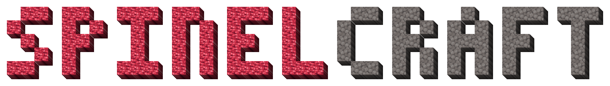
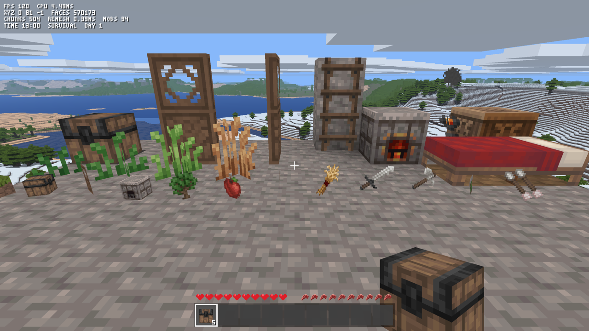

# 

A small Minecraft-like game written in Ruby. The Spinel compiler turns the Ruby into a native executable, and SDL3 GPU (Metal on macOS) draws it. All game logic is Ruby. The only C is a thin layer in `game/gfx.rb` that passes data to SDL.


## Screenshots

| | |
| --- | --- |
|  |  |
|  |  |




`tools/gallery.sh` renders these images again.

## Build and run

You need macOS and a built Spinel compiler. `brew bundle` installs the libraries in `Brewfile`.

```sh
./build.sh      # writes ./spinelcraft
./spinelcraft
```

`build.sh` uses `$SPINEL` if you set it. Otherwise it uses `spinel` from `PATH`, and then `~/Documents/dev/oss/spinel/spinel`. Use a recent Spinel.

The game saves to `world.sav` in the current directory and loads it at start. To get a new world, delete the file or start with `NEW=1`.

## Controls

| Key | Action |
| --- | --- |
| WASD, mouse | Move, look |
| Space | Jump, swim up, fly up; double-tap: fly (creative) |
| Left Shift | Sneak, fly down, get out of a boat |
| Left Ctrl, double-tap W | Sprint |
| Left click | Break a block, attack |
| Right click | Place a block, use an item or a block, throw an egg, get in a boat |
| 1–9, wheel | Select a hotbar slot |
| E | Inventory and crafting |
| F3 | Debug text |
| F5 | Save |
| T, / | Chat and commands |
| Esc | Pause, play again |

The game starts on a title screen, with buttons to play, to start a new world, and to quit. The pause menu has sliders for brightness, volume and render distance, and buttons for fullscreen, the debug text, and save and quit to the title.

In survival, start by punching a tree. The inventory shows a recipe after you have had its ingredient. Some recipes need a crafting table or a furnace near you.

## What is in it

- An endless generated world with continents, rivers, mountains and nine biomes, from snowy taiga to desert and jungle, plus caves, ores and trees.
- A day and night cycle, rain, flowing water and lava, and torch light.
- Creative and survival modes, with health, hunger, tools, crafting and smelting.
- Animals, and monsters that come out in the dark. Shears take the wool of a sheep, but not of a baby sheep, and the sheep grows it back when it eats grass. A bucket milks a cow, and the milk ends the Hunger effect. A chicken lays an egg every 5 to 10 minutes. A thrown egg hatches a chick 1 time in 8. Wheat puts a cow, a sheep or a pig in love mode, and seeds put a chicken in love mode. Two animals of one kind in love mode make a baby, which grows up in 20 minutes. An animal follows a player who holds its food.
- Boats of oak, spruce and birch. Put one on water, get in, and paddle with WASD.
- Pumpkin patches. Shears cut leaves and wool fast, and carve a face into a pumpkin, and a carved pumpkin and a torch make a jack o'lantern, which lights the night. Pumpkin seeds grow a stem, and the stem grows new pumpkins. On October 31, some monsters wear a pumpkin on their heads.
- Bone meal. Skeletons drop bones, and a bone makes 3 bone meal. Bone meal makes a crop, a pumpkin stem or a sapling grow, and grows tall grass and flowers on a grass block.
- A view distance of up to 5000 blocks.
- A chat line with commands, as in Minecraft.
- Sounds from VoxeLibre, under free licenses. `assets/sounds/CREDITS.md` names the author and the license of each file.
- Music from VoxeLibre, under free licenses. `assets/music/CREDITS.md` names the author and the license of each track.

## Commands

T opens the chat line, and / opens it with a slash. The chat frees the mouse while it is open. Enter runs the line, Esc closes it, and Up and Down bring back the lines that you typed before. Cmd+V (Ctrl+V on other systems) pastes the text of the clipboard, without the line breaks and the characters that the font cannot draw. Tab completes a command name, an item name in `/give` and a mob name in `/summon`, and each next Tab puts the next name on the line. The names that fit show above the line. A line that starts with a slash is a command. The commands follow the syntax of Minecraft, and `~` gives a coordinate relative to the player.

| Command | Effect |
| --- | --- |
| `/time set day\|noon\|night\|midnight\|<time>` | Set the time of day. A time is in ticks, or has the unit `d` (days), `s` (seconds) or `t` (ticks) |
| `/time add <time>` | Move the clock forward |
| `/time query` | Show the time in ticks and the day |
| `/weather clear\|rain` | Stop or start the rain. No key does this |
| `/gamemode survival\|creative` | Switch between survival and creative. No key does this |
| `/tp <x> <y> <z>` | Go to a place, for example `/tp ~ ~10 ~` |
| `/give <item> [count]` | Get an item, for example `/give diamond_pickaxe` |
| `/summon <pig\|sheep\|cow\|chicken\|zombie\|skeleton\|creeper> [x y z]` | Make a mob, 3 blocks in front of you or at a place |
| `/kill` | Die |
| `/seed` | Show the seed of the world |
| `/spawn` | Go to the spawn point |
| `/help` | List the commands |

## Layout

`build.sh` compiles `main.rb`, and `main.rb` requires the files in `game/`. Each file that starts with `class Game` holds a part of the `Game` class. The other files each hold their own class or module. The game loads the OGG files in `assets/sounds` and `assets/music` from the folder of the executable.

Most textures are PNG images in `assets/`, and the game loads them at startup from the folder that holds the executable. `game/textures.rb` draws the rest in code: the block cracks, the smoke, the rain and the font. Each texture layer is one line in `game/textures.rb`, such as `COAL = image("coal")`, and it takes the next free layer number.

Each block and item is one `Block.define_block` call in `game/block.rb`, in the order of the block ids. The call names only what differs from a solid cube that drops itself. To add a block, give it the next id, add its `define_block` line and its texture line, and put it in `CREATIVE_ITEMS` in `game/constants.rb`.

## Rendering

The mesher writes one record of two 32-bit words for each visible face. The record holds the position, the face direction, the texture layer, ambient occlusion for each corner, sky light and torch light. The vertex shader turns each record into a quad with an indexed draw. Each chunk sorts its faces by direction, so the renderer skips the directions that cannot face the camera. That removes about a third of the faces. The renderer also skips chunks outside the view frustum or past the fog. Water draws after the opaque blocks, from back to front.

The records of all chunks and far tiles share one GPU buffer, so each pass binds one vertex buffer and each draw selects its range. A changed mesh goes to a new range, and its old range becomes free 3 frames later, when no frame on the GPU can still read it. The buffer starts at 32 MB and doubles when it is full.

Distance haze mixes each pixel toward the sky color by `1 - e^(-d / 1800)`, where `d` is the distance in blocks. That is about 10% at 200 blocks, 60% at 1600 and 94% at 5000, so far land gets paler and the horizon has no hard edge.

## Streaming

The loaded area is a ring of 64 × 64 chunk slots, 1024 × 1024 blocks. World chunk (cx, cz) lives in slot (cx & 63, cz & 63). The blocks stay in one flat array, so the mesher, the light flood and the physics read neighbors with plain index offsets. Each Integer of the array holds 8 blocks, one byte each. That keeps the array at about 100 MB instead of 800 MB. A padding column on each side of the array holds a copy of the opposite edge, so the offsets also work where the ring wraps.

Each frame, `stream_around` loads the missing chunks around the player, nearest first, and meshes each chunk whose neighbors have loaded. The radius follows the view distance, up to 31 chunks, and the work stops after 2.5 ms. At start and on respawn, the nearest 17 × 17 chunks load before play starts, and the rest stream in. When a new chunk needs a slot, the old chunk in it goes to the store if you changed it. Vertices hold the ring column (0 to 1023), and the vertex shader moves each one to the copy nearest the camera.

Trees can cross chunk edges. A chunk asks the noise functions, not its neighbors, where the trees next door grow, so each chunk makes its part of a tree without the other chunk loaded.

## Terrain

The terrain follows the method of Minecraft 1.18, in a smaller form. Each column reads a few noise fields:

- The continent field picks deep ocean, ocean, coast, lowland or highland. A spline (a line through fixed points) turns it into a base height.
- The erosion field picks flat or rugged land. Only rugged land gets high hills, and only rugged land away from the coast gets ridged mountains.
- Where the river field is near zero, the land sinks into a valley with a river bed below the sea.
- The temperature and humidity fields pick the biome (`game/biome.rb`). The air gets colder up high, so mountains get snow.

The large fields read positions that another noise field moves by up to 90 blocks. This domain warp bends the coasts, rivers and biome edges, so they do not look like round blobs.

## Far terrain

Past 400 blocks, the game draws far terrain instead of chunks. Far terrain has 4 levels. Level L has cells of 4 << L blocks and reaches 640 << L blocks (640, 1280, 2560 and 5120). So each level has about the same number of tiles, and each doubling of the view distance costs about the same. A far tile is 16 × 16 cells.

Each cell takes one sample from the generator's noise at its center. The sample gives the cell's height and top block, and forests get a raised canopy of leaves. So far terrain needs no block storage. A tile takes about 0.05 ms to build and has about 560 faces.

Each level keeps its tiles in its own ring, and a separate vertex shader scales each face to its cell. Full-detail chunks draw out to the last complete ring of meshed chunks. Each far level discards its pixels inside the square that the next finer level covers with complete rings. So no two levels overlap, and while a level loads, the coarser level shows behind it. Far terrain does not show your edits, and it has no caves or overhangs.

## Performance

These numbers come from an M4 Pro Mac at 2560 × 1440 and the default 1600-block view, with a video call and other apps open. To measure them yourself, run `FRAMES=2400 AUTOPILOT=far GPUTIME=1 ./spinelcraft`. The CPU time of a frame includes the draw calls, but not the time that the frame waits for the display or the GPU.

| Measurement | Value |
| --- | --- |
| Generating and meshing the nearest 289 chunks at start | about 115 ms (the rest stream in) |
| Streaming while you move | up to 2.5 ms per frame, about 0.55 ms per chunk |
| Remeshing after a block edit | about 1 ms; torch light and water spread over the next frames within a 1 ms budget |
| CPU time per frame | about 2.1 ms while flying in a circle; about 4 ms while flying straight, with chunks streaming in |
| Worst CPU frame | about 5.5 ms while chunks and far tiles stream in |
| GPU time per frame | about 5 to 7 ms |
| Frame rate | the display rate (120 fps on the built-in display) |

## Test switches

| Variable | Effect |
| --- | --- |
| `FRAMES=n` | Quit after n frames and print timings. The game ignores the mouse and the keys. |
| `SHOT=file.ppm` | Save the last frame as an image (use with `FRAMES`) |
| `CAM=x,y,z,yaw,pitch` | Start as a flying camera at that place |
| `AUTOPILOT=1` | Fly in a circle (for benchmarks) |
| `AUTOPILOT=far` | Fly in a straight line, so chunks stream in all the time |
| `DEMO=1` | Dig and place blocks in front of the player |
| `GPUTIME=1` | Wait for the GPU each frame and print the GPU time |
| `MODE=survival` | Start in survival |
| `TIME=0.75` | Start at that time of day (0.75 is midnight) |
| `DAY=n` | Start on day n. The moon phase is n % 8, and 0 is the full moon |
| `SEED=n` | World seed |
| `NEW=1` | Ignore `world.sav` |
| `SAVE=1` | Save on quit also when `FRAMES` is set |
| `MUTE=1` | No sound |
| `SHOWMOBS=1` | Put one mob of each kind, and a chick, on a stone floor in front of the player |
| `SHOWBOATS=1` | Put a boat of each wood on a pool of water, with the player in one |
| `SHOWITEMS=1` | Put a row of dropped items on a stone floor in front of the player. `HAND=id` holds block `id` (0 for the empty hand) |
| `INVENTORY=1` | Start with the inventory open |
| `RAIN=1` | Start in the rain |
| `HALLOWEEN=1` | Play as on October 31: some zombies and skeletons wear a carved pumpkin or a jack o'lantern. With `SHOWMOBS=1`, the zombie and the skeleton wear one |
| `SELFTEST=1` | Check the game rules and print PASS or FAIL for each, then the totals. The exit status is 1 when a rule fails |
| `VIEW=200` | Start with that view distance |
| `NOVSYNC=1` | Ask for no vsync |
| `LOG=save,mobs` | Write the debug log of these topics to stderr (see [Debug log](#debug-log)) |

`SELFTEST=1` writes and deletes its own save and options files in the temporary folder (`$TMPDIR`). It does not read or change `world.sav` or `options.txt`. `tools/selftest.sh` builds the game, runs the self-test, and prints only the FAIL lines and the totals.

## Debug log

`LOG` turns on the debug log for a list of topics, and `LOG=all` turns on all of them. Each line goes to stderr, with the seconds since the start and the topic:

```sh
LOG=save,frame ./spinelcraft 2>debug.log
```

| Topic | Lines |
| --- | --- |
| `save` | The size and the contents of each save, each load, and why a save did not load |
| `world` | Each new world and its seed, the spawn point, and each respawn |
| `stream` | Each time the player goes into a new chunk: the chunks loaded and meshed, and the far tiles built, since the last new chunk |
| `mobs` | Each mob that spawns, and each mob that dies, despawns or is out of the loaded chunks |
| `frame` | Each frame that takes more than 8 ms of CPU time, with the time of each step: update, chunks, far tiles, remesh and render |

A topic that is off costs one array read, and the game builds no string for it. To add a line, call `Log.debug(Log::SAVE) { "text" }`. The block runs only when the topic is on. Do not put log calls in the loops of `World`, `Noise`, `Mesher` or `Lod`.

F3 shows the frame rate, the CPU time, the position, the faces drawn, the visible chunks, the remesh time, the mob count, the day and the time on the screen.

## Tests

`rake test` runs the Minitest tests in `test/` under CRuby, with no build. They check the game classes that do not need the `Game` object or `Gfx`, such as `World`, `Player`, `Command` and `Music`. Spinel does not compile Minitest, so the self-test (`SELFTEST=1`) checks the compiled game and the rules of `Game`.

`tools/shot.sh out.png [VAR=value ...]` renders frames and saves the last one as a PNG. `tools/gallery.sh` renders the README screenshots. `tools/count.rb` counts the generated blocks by type, and it also runs under CRuby. `ruby tools/map.rb [OUT]` draws the generated world without the game: `OUT-top.png` from above and `OUT-tilt.png` at a slant, with biome colors, water depth and spawn. `SEED`, `SIZE`, `STEP` and `LIFT` change the map.

`tools/bench.sh [REF]` compares the working tree with a git ref (`main` by default). It builds both, runs each `N` times in turns (3 by default) with `AUTOPILOT=1`, and prints the median world generation time and CPU time per frame. It also prints two counts from Spinel that go up when a value loses its type: the `sp_box` calls in the C and the `--warn-widen` warnings.

`tools/box_diff.sh base.c new.c` shows where the `sp_box` count changed. It takes two outputs of `spinel main.rb -S`, and it prints each C function whose count of `sp_box` calls differs, with the count in each file.

## Credits

The images in `assets/pixel-perfection` come from Pixel Perfection by Hugh "XSSheep" Rutland, as changed by the VoxeLibre and Mineclonia contributors. They have the [CC BY-SA 4.0](https://creativecommons.org/licenses/by-sa/4.0/) license. `assets/pixel-perfection/README.md` gives the sources.
